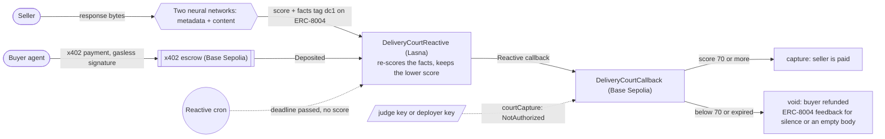
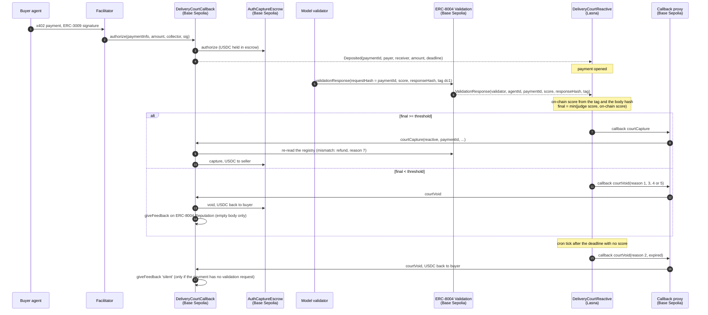
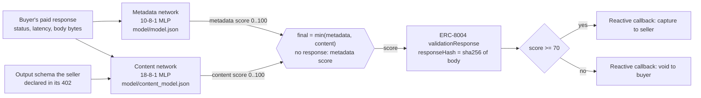

# Delivery Court

**x402 pays before anyone looks. Delivery Court makes the money wait for a verdict.**

vet402, my x402 buyer service, has paid sellers 15,128 times (snapshot 2026-11-21). 1,251 are not labeled delivered: 1,124 not_established, 736 of those a 4xx vet402 calls inconclusive, plus 127 with no body (about 1 in 12), and every one settled anyway ([data](#delivery-model-model)). In Delivery Court the USDC sits in the official x402 escrow, a neural network judges what came back, and a Reactive contract pays the seller or refunds the buyer. The recorded silent run refunded the buyer 116 s after payment. The cron is paused until 2026-12-05 for fuel (CHECKLIST). Nobody else can move the money: the judge key only writes a score, and the contracts decide.

`Reactive Omni Buildathon · Reactive Meets AI · Base Sepolia + Reactive Lasna (testnet only)`

## 60-second judge quickstart

| What | Where |
|---|---|
| Live try | https://delivery-court.fly.dev (`POST /try/deliver`) |
| Docket (RPC only) | https://delivery-court.fly.dev/docket/ |
| 1 Buyer pays | [0x3705f430…01cd5c](https://sepolia.basescan.org/tx/0x3705f4307bfe8bf8477ff4dcce4cbe866ed3d44f76a64120e0187dd92f01cd5c) Base Sepolia `authorize` |
| 2 Case opens | [0x9fa07f81…800afe](https://lasna.reactscan.net/tx/0x9fa07f815b588156a53318309992f94f369a04a6b5fa42d31dd1fb8451800afe) Lasna `Deposited` react |
| 3 Verdict | [0xb9ef16ac…feb7be](https://lasna.reactscan.net/tx/0xb9ef16acdfa5f112c99e54039a2f80a47feeb52c992d6045e39b7a801dfeb7be) Lasna decision react |
| 4 Settlement | [0xb796e6e7…fbd465](https://sepolia.basescan.org/tx/0xb796e6e75349997d876a5c76353f4d003dde1b64637e88861b4314d283fbd465) Base capture callback |
| Sourcify | [Callback 84532](https://sourcify.dev/server/v2/contract/84532/0xD80dfBa59a5930B943D0Eb5225E292B0ffB9D84a) · [Reactive 5318007](https://sourcify.dev/server/v2/contract/5318007/0x7FeF8eAF662CFb82adaa1cA3E45821A866cC4D51) |
| Re-check a score | `cd offchain && node src/rejudge.mjs <validationResponse tx> [...]` |
| Judge cannot steal | `courtCapture` from judge `0x5eC4…F0bC` reverts `NotAuthorized` (eth_call, [below](#would-this-be-simpler-without-reactive)) |
| Reactive MCP | `https://mcp.rnk.dev/mcp` read-only: `get_rc_health` / `list_subscriptions` on `0x7FeF…4D51` |

Inspect the live reactive contract with [Reactive MCP](https://blog.reactive.network/reactive-mcp-live-diagnosis-for-reactive-contracts/) (public endpoint, no login): point Cursor or Claude at `https://mcp.rnk.dev/mcp` and call `get_rc_health` and `list_subscriptions` on `0x7FeF8eAF662CFb82adaa1cA3E45821A866cC4D51` on Lasna. On 2026-11-23: **OK_SUBSCRIBED** (Deposited + ValidationResponse filters active), **LOW_RESERVES** (likely) with Omni reserves 0 while the contract balance was 157.76 lREACT and `cronPaused` was true.

## Try it (30 seconds, no wallet)

Open **https://delivery-court.fly.dev** and press a button. The server pays 0.01 test USDC and links every transaction as it confirms, then shows payment to settlement in block timestamps. GET `/try/deliver` returns 404. Use POST. The page may show "cron paused". Deliver and empty still work. Cron must be on for new silent refunds.

```sh
curl -sL -X POST https://delivery-court.fly.dev/try/deliver     # {"run":"<id>"}
curl -sL https://delivery-court.fly.dev/runs/<id>               # steps, score, capture or void
```

Pay with your own Base Sepolia wallet (0.01 USDC, no gas): `cd offchain && npm ci && BUYER_PRIVATE_KEY=0x... node src/pay.mjs https://delivery-court.fly.dev/empty/resource`. It pays with the official x402 client, signs what it received with the same key and posts it to `/judge`.

Every case of the last 24 h, rebuilt in your browser from the public RPCs (nothing from this server): **https://delivery-court.fly.dev/docket/**. For sellers, the steps are in [docs/SELLER.md](docs/SELLER.md): captureAuthorizer, a body signature, an ERC-8004 validation request, and registerSeller by the court owner.

## Three cases, on chain

| Case | What the buyer got | Score | Outcome | Callback (Base Sepolia) |
|---|---|---|---|---|
| Delivered | 200, JSON that matches the declared schema | 99 | paid to the seller (reason 0) | [0xb796e6e7…fbd465](https://sepolia.basescan.org/tx/0xb796e6e75349997d876a5c76353f4d003dde1b64637e88861b4314d283fbd465) |
| Empty | 200 OK, 0 bytes | 0 | refunded + ERC-8004 feedback (reason 3, empty body hash) | [0xfc6d9aad…24ae42](https://sepolia.basescan.org/tx/0xfc6d9aad7a91fa2d62bd2780dc5b4118cb05c86a17bf44c4d93555cd7224ae42) |
| Silent | nothing | none | refunded by the Reactive cron 116 s after payment + ERC-8004 feedback (reason 2) | [0xe4a424d0…830c76](https://sepolia.basescan.org/tx/0xe4a424d02482f26c2f2c2dbe568a7bfb7cce76ace2e8217a4d645c321f830c76) |
| Judge says 99 for an empty body | 200 OK, 0 bytes, judge key writes 99 | judge 99, on chain 0 | refunded (reason 3): the reactive contract re-scored the facts | [0xbc05ddb3…b7b417](https://sepolia.basescan.org/tx/0xbc05ddb3c1a2ab64415974bee28550dda3eca6310184c67a14ff80f0e8b7b417) |

Full loops (payment, Lasna react, ERC-8004 score, Lasna decision, callback): [Transactions](#transactions). Payment to settlement: median 5 s, p95 12 s over 30 runs ([Latency](#latency-30-runs)).



## Would this be simpler without Reactive?

No. Four things stop if the reactive contract is removed:

1. **The judge never touches money.** The judge key writes a standard ERC-8004 `validationResponse` and nothing else. It knows no escrow, holds no operator role, and cannot call capture or void (`courtCapture` from the judge key reverts with `NotAuthorized(0x5eC4…F0bC, 0x476F…8585)`, an eth_call checked 2026-11-22). The Reactive contract is what turns a registry entry into a payment decision. Point it at another ERC-8004 validator and no contract code changes.
2. **Nobody has to show up.** Three unmodified pieces (the official x402 escrow, the ERC-8004 registry, a time signal) are joined by Reactive with nobody online. A permissionless `settle()` would still need someone awake with gas for every payment. x402 buyers sign gasless and may be offline, and a silent seller writes nothing at all. Only the cron moves that refund (116 s after payment in the silent scene).
3. **Only the callback can refund early.** Before expiry the buyer's own `reclaim` reverts, so the Reactive callback (`onlyCallbackSender(reactiveSender)`) is the only path that returns the money before the deadline.
4. **The judge can lower a score, never raise it.** The judge commits the facts with its score: the sha256 of the body and a tag `dc1:<status>:<bodyBytes>:<latencyMs>`. The reactive contract computes its own score from those facts on chain (`src/scoring/ScoreGuard.sol`, `MetaNet.sol`) and decides on `min(judge score, on-chain score)`. An empty body is caught by its hash alone and scores 0. In the [judge-99 scene](#the-judge-says-99-for-an-empty-body) the judge key wrote 99 for an empty body and the reactive contract emitted `ScoreChecked(99, 0, 0, guard 1)` and refunded the buyer (reason 3).

## Don't trust the judge: re-run it

The judge key can only write a score, and every score can be checked by anyone:

```sh
cd offchain && npm ci
node src/rejudge.mjs 0xe85526853749719ce4d5190d41efc8db772842d13954f9b80aaad221f836f34a 0xb4b5934e68f7f0e8ae39b1b5d5027739e6b9821fa7f0f3a8d09b93660a591acd
# 0xe8552685… on-chain 99 / recomputed 99 / match, tag match (body 151 bytes, sha256 checked)
# 0xb4b5934e… on-chain 0 / recomputed 0 / match, tag match (body 0 bytes, sha256 checked)
```

It reads the `validationResponse` call (and checks it came from the judge to the ERC-8004 registry), downloads the record at `responseURI` and the exact body it names, checks `sha256(body) == responseHash`, checks the `dc1` tag (status, bytes, latency) against the body and the record, and re-runs both networks with the model files in this repository. Any live run works too: take `steps.validationResponse` from `/runs/<id>`.

## Reason codes

Every decision carries a reason, as the last value of the Lasna `Decision` log and of the Base Sepolia `Resolved` log.

| Reason | Meaning | Outcome | ERC-8004 feedback |
|---|---|---|---|
| 0 | final score 70 or more | capture | no |
| 1 | final score below 70, facts consistent | void | no |
| 2 | no score before the deadline (silent seller), voided on a cron tick | void | yes, to the agent the seller was registered with |
| 3 | `responseHash` is the sha256 of an empty body, whatever the judge said | void | yes |
| 4 | the `dc1` tag is missing or malformed | void | no |
| 5 | the tag says 0 bytes while `responseHash` is non-empty | void | no |
| 6 | a score arrived after the deadline | void | no |
| 7 | the callback re-read the ValidationRegistry before capture and it did not match | void (the callback switches to a refund) | no |

The final score is `min(judge score, on-chain score)`. The on-chain score is computed by the reactive contract from the tag `dc1:<status>:<bodyBytes>:<latencyMs>` and the body hash that the judge commits with its score (`ScoreChecked(paymentId, reported, onchain, final, guard)` on Lasna). The 'silent' feedback (reason 2) is written only when the payment has no ERC-8004 validation request at all. Anyone can file the first request for a paymentId, so without this rule a third party could file one first and get the seller a 'silent' review (fork test `test_fork_frontRunRequest_noSilentReviewForTheSeller`).

## Known limits

- Fixed in v2, the cron window: `authorize` takes only sellers the owner registered, 0.001 USDC or more, and an expiry at most 1 hour ahead. The cron reads 32 queued payments from its cursor, continues past them on the next tick and wraps at the end, and decided payments leave the queue. With N payments before their deadline, an expired one is reached within ceil(N/32) cron ticks (`test/unit/CronStarvation.t.sol`: a payment in the middle of 200 is refunded on the 4th tick, at most 7). With Cron100 (about 2 minutes) that is at most about 14 minutes late for 200 payments. After the deadline the buyer can also call `reclaim` on the escrow.
- Fixed in v2, feedback on low scores: ERC-8004 feedback is written only for silence (reason 2) and an empty body (reason 3), not for a low score. A search that honestly found nothing (`{"results":[]}`) can still score low and be refunded, but it leaves no review ([Model limits](#model-limits)).
- A stolen judge key can lower a score and keep a seller from being paid (the buyer is refunded). It cannot raise one. The on-chain network gives almost 100 to any 200 with a non-empty body, so judging the content (is it JSON, is it an error page) still rests with the judge key alone.
- The body is reported by the buyer. For this server's own sellers the court also keeps the seller's copy (status and sha256 of the bytes it sent) and refuses a post that differs. For an outside seller in production the seller would sign its response so neither side can report alone.
- Testnet only. The live server and the cron run on testnet funds.

## Live server

Limits of the live server: testnet only, one server-paid run at a time, 30 s apart, 40 a UTC day. It refuses a run before signing anything when a testnet balance is low (`/health` lists them). For a payment from your own wallet, the court scores the body you post, signed by the wallet that paid (EIP-191 over `delivery-court:judge:<paymentId>:0x<sha256(body)>:<status>`), so the record says `bodyReportedBy: buyer, posted to /judge`. `/judge` refuses payments made by the server's own buyer (the server judges those itself), unsigned or wrongly signed bodies, and more than 5 calls a minute per caller. Judgment records and bodies are served at `/responses/<file>` and the `responseURI` on chain is that full URL. Code: `offchain/src/server.mjs`, `offchain/public/index.html`, `Dockerfile`, `fly.toml`. The server holds the buyer, seller, judge and relayer testnet keys, never the deployer key. Runs on Fly through judging (owner-approved). Stop on 2027-01-01 per CHECKLIST and fly.toml.

The live server runs on the v2 pair. Runs on 2026-11-22: the delivering seller scored 99 and captured, 8 s from payment to settlement, and the empty seller scored 0 and voided, 8 s from payment to settlement. The first runs on the v1 pair are in [docs/HISTORY.md](docs/HISTORY.md).

## How it works

The escrow is the official x402 `auth-capture` escrow (`AuthCaptureEscrow` v1.1 from base/commerce-payments, already deployed on Base Sepolia). `DeliveryCourtCallback` is the payment's `operator`, the `"custom"` operator type in the x402 auth-capture EVM spec. Collect (`authorize`) is open to any facilitator, for sellers the owner registered, 0.001 USDC or more, with an expiry at most 1 hour ahead. Capture and void can only come from the Reactive callback proxy on behalf of the paired reactive contract on Lasna.



Why Reactive is required here:

- Release and refund need a caller that is not a key holder. A bot would let whoever holds the bot key move the money. The callback proxy only accepts calls that a reactive contract requested, and the callback contract only accepts the one reactive contract it was deployed with.
- The expiry refund runs on a Reactive cron, so the buyer gets the money back even if nobody is online.
- Before the authorization expiry the buyer cannot take the money back alone. `AuthCaptureEscrow.reclaim` reverts with `BeforeAuthorizationExpiry` while `block.timestamp < authorizationExpiry` (`lib/commerce-payments/src/AuthCaptureEscrow.sol`, lines 323 to 327), and `void` only accepts the operator (line 304). The operator is `DeliveryCourtCallback`, and it only acts on a Reactive callback. So before the deadline, the callback is the only way to return the money.
- After the expiry the buyer can call `reclaim` alone. The cron is there so the buyer gets the money back even while the buyer agent is offline or has no gas.

What stops if Reactive is removed:

| Without | What happens |
|---|---|
| The reactive contract on Lasna | No one can call `courtCapture` or `courtVoid`. A delivering seller is never paid. A buyer of an empty answer waits until the expiry and must send `reclaim` alone. The model's score has no effect on the money. |
| The callback proxy | `DeliveryCourtCallback` refuses every capture and void, because both check `msg.sender` is the proxy and the first argument is the paired reactive contract. |
| The cron | Payments with no score stay locked until the buyer is online after the expiry. |

Why the model is required here: without a score, every payment expires and returns to the buyer. The score decides where the money goes.

## Contracts

| Contract | Chain | Role |
|---|---|---|
| `src/DeliveryCourtCallback.sol` | Base Sepolia | x402 auth-capture custom operator. `authorize` open to any facilitator for registered sellers (0.001 USDC or more, expiry within 1 hour), refuses `charge`, `courtCapture` and `courtVoid` only from the callback proxy with the paired reactive contract as first argument. Re-reads the ValidationRegistry before capture. Writes ERC-8004 feedback on a refund for silence or an empty body. |
| `src/DeliveryCourtReactive.sol` | Lasna | Subscribes to `Deposited`, to `ValidationResponse` filtered by the model validator, and to Cron100. Re-scores the committed facts and decides capture or void. |
| `src/CourtCallbackBase.sol` | Base Sepolia | Shared one-decision-per-payment logic, seller registry, reentrancy guard, feedback. |
| `src/CourtReactiveBase.sol` | Lasna | Shared scoring (`min(judge, on-chain)`), threshold, reason codes, wrapping expiry scan. |
| `src/scoring/ScoreGuard.sol`, `MetaNet.sol` | Lasna | Parses the `dc1` tag, catches the empty body hash, runs the metadata network on chain. |
| `src/fallback/DeliveryEscrowB.sol` | Base Sepolia | Fallback design. Per-seller escrow that receives USDC directly from the official `exact` facilitator. |
| `src/fallback/DeliveryCourtReactiveB.sol` | Lasna | Fallback design. Reads USDC `Transfer(to = escrow)` and records the deposit through a callback. |

External contracts on Base Sepolia (chain id 84532):

| Name | Address |
|---|---|
| AuthCaptureEscrow v1.1 | `0xf96815976523E00e65Be8f34cA5e64b4f41EB19c` |
| ERC3009PaymentCollector v1.1 | `0x8612dfdc421f80336cd14E8EF9cb1E765dB5ab88` |
| USDC | `0x036CbD53842c5426634e7929541eC2318f3dCF7e` |
| Reactive callback proxy | `0x476F44b11F5C942c58f4c8E3d0300E5710743585` |
| ERC-8004 IdentityRegistry | `0x8004A818BFB912233c491871b3d84c89A494BD9e` |
| ERC-8004 ReputationRegistry | `0x8004B663056A597Dffe9eCcC1965A193B7388713` |
| ERC-8004 ValidationRegistry | `0x8004Cb1BF31DAf7788923b405b754f57acEB4272` |

Linking a judgment to a payment: the seller files `validationRequest` with `requestHash = paymentId` (the escrow's `getHash(paymentInfo)`) and names the model as validator. The reactive contract only listens to that validator. The first response wins.

## Deployed addresses

Current pair, v2 (deployed 2026-11-22). The reactive contract listens to the judge role as its only validator and re-scores its facts on chain. Record: `deployments/v2.json`.

| Contract | Chain | Address | Deploy tx |
|---|---|---|---|
| DeliveryCourtReactive | Lasna | [`0x7FeF8eAF662CFb82adaa1cA3E45821A866cC4D51`](https://lasna.reactscan.net/address/0x7FeF8eAF662CFb82adaa1cA3E45821A866cC4D51) | [0x9a95a048…6c330c](https://lasna.reactscan.net/tx/0x9a95a0485d024b73e4cbe75de27897a40acc6fd1f013fb4b174ae8462c6b330c) |
| DeliveryCourtCallback | Base Sepolia | [`0xD80dfBa59a5930B943D0Eb5225E292B0ffB9D84a`](https://sepolia.basescan.org/address/0xD80dfBa59a5930B943D0Eb5225E292B0ffB9D84a) | [0xb6a8bfbc…ff2f47](https://sepolia.basescan.org/tx/0xb6a8bfbc65fc07f99004ce5fac9a58bb95a9b72428dc73f86d2d2fda92ff2f47) |

Registered sellers: seller-deliver (agent 10798), seller-empty (agent 10799), seller-silent (agent 10801, registered in [0x5c987c07…17781e](https://sepolia.basescan.org/tx/0x5c987c07fc194843120cb662687958a6808929356d9bf7fb17e1b26e2517781e)). Registration files: `agents/seller-deliver.json`, `seller-empty.json`, `seller-silent.json`.

The v1 pair, earlier pairs, the stage 0 manual judgment, the first metadata-only judge and every earlier setup transaction: [docs/HISTORY.md](docs/HISTORY.md).

The callback source is verified on Sourcify with a match (creation and runtime): https://sourcify.dev/server/v2/contract/84532/0xD80dfBa59a5930B943D0Eb5225E292B0ffB9D84a . Blockscout shows it verified (`is_verified: true`). The reactive source is verified on Sourcify with a match (creation and runtime): https://sourcify.dev/server/v2/contract/5318007/0x7FeF8eAF662CFb82adaa1cA3E45821A866cC4D51 (verified 2026-11-23).

## Roles

Every role has its own account. Each key is derived from the testnet deployer key as `keccak256(deployer key || "delivery-court:<role>")` by `offchain/src/derive-roles.mjs` and lives only outside this repo. `scripts/check-no-keys.py` fails if any key value appears in the tree or in git history. Public addresses are in `deployments/roles.json`.

| Role | Address | Does |
|---|---|---|
| buyer | `0xBd857a30e35bA99f8Edab20B41baA3A4272c154d` | Signs the x402 payment (ERC-3009). Pays no gas. |
| seller-deliver | `0xF98F6b4D8f1a5A03271bBf2bee23236737D9EC31` | payTo of the delivering seller, ERC-8004 agent 10798 |
| seller-empty | `0x8Dba1A8aeD6Ab7F1e2037bfC295f3a0A00BE072F` | payTo of the empty-body seller, ERC-8004 agent 10799 |
| seller-silent | `0x4151f916c1bd18dF1324Fa0Edd9F8Fa5bA8AD0F2` | payTo of the seller that never answers, ERC-8004 agent 10801 |
| judge | `0x5eC4599A438fA0559aDe8b8551b369D5c5aDF0bC` | Runs the model and writes `validationResponse` |
| relayer | `0xcECe20a6215ced9c36D8Fcf8929A3b0A71f911f1` | Facilitator submitter, sends `authorize` |
| deployer | `0x6db137549302E9b98abcB2a275b642f485895E2d` | Deploys, funds roles, pauses and resumes the cron |

## Transactions

Each scene shows the full loop: origin event, reactive transaction, callback transaction.

### Scenes judged by both networks (current model)

Model version `sha256:71d5a10978ed1106eceae249f3361f7018b718868fc3448881910ff454d90250` (`model/judge.json`). Run on the v2 pair on 2026-11-21 23:48 UTC (2026-11-22 JST) with `node src/run-scenes.mjs deliver empty silent`. The v1 tables are in [docs/HISTORY.md](docs/HISTORY.md).

| Scene | x402 payment: `authorize` (Base Sepolia) | Deposited react (Lasna) | Seller request, model score (Base Sepolia) | Decision react (Lasna) | Callback (Base Sepolia) | Buyer / seller USDC before, held, after |
|---|---|---|---|---|---|---|
| Delivering seller (200, JSON body), capture, reason 0 | [0x3705f430…01cd5c](https://sepolia.basescan.org/tx/0x3705f4307bfe8bf8477ff4dcce4cbe866ed3d44f76a64120e0187dd92f01cd5c) | [0x9fa07f81…800afe](https://lasna.reactscan.net/tx/0x9fa07f815b588156a53318309992f94f369a04a6b5fa42d31dd1fb8451800afe) | request [0x003250c7…3f4b2b](https://sepolia.basescan.org/tx/0x003250c7e9869b2c94ea7497a5d6a4d9c42d9c94f71de06b5002fa34ae3f4b2b), score 99 [0xe8552685…36f34a](https://sepolia.basescan.org/tx/0xe85526853749719ce4d5190d41efc8db772842d13954f9b80aaad221f836f34a) | [0xb9ef16ac…feb7be](https://lasna.reactscan.net/tx/0xb9ef16acdfa5f112c99e54039a2f80a47feeb52c992d6045e39b7a801dfeb7be) | capture [0xb796e6e7…fbd465](https://sepolia.basescan.org/tx/0xb796e6e75349997d876a5c76353f4d003dde1b64637e88861b4314d283fbd465) | 1.61 / 0.38, 1.60 / 0.38, 1.60 / 0.39 |
| Empty body (200, 0 bytes), refund and feedback, reason 3 | [0xeedd718c…6393c0](https://sepolia.basescan.org/tx/0xeedd718ccda44227ba32e920b8af5885220c744b49bf2b83549f260a666393c0) | [0x36b1cd46…3ae7c9](https://lasna.reactscan.net/tx/0x36b1cd468637715128dc066d9fdcd627739e911bf8b638baa9af2d93093ae7c9) | request [0xd51acced…42772d](https://sepolia.basescan.org/tx/0xd51accedf0b5f2741b5fd0d108a3870b9f4717e7b5dccbf35cb8a6e0da42772d), score 0 [0xb4b5934e…591acd](https://sepolia.basescan.org/tx/0xb4b5934e68f7f0e8ae39b1b5d5027739e6b9821fa7f0f3a8d09b93660a591acd) | [0xfd1476da…e723e0](https://lasna.reactscan.net/tx/0xfd1476da24fdc01e675f276b6a95bedb1b3caf04febd383020f01f50d6e723e0) | void + ERC-8004 feedback [0xfc6d9aad…24ae42](https://sepolia.basescan.org/tx/0xfc6d9aad7a91fa2d62bd2780dc5b4118cb05c86a17bf44c4d93555cd7224ae42) | 1.60 / 0.00, 1.59 / 0.00, 1.60 / 0.00 |
| Silent seller (no answer), cron refund, reason 2 | [0x8d56aefd…600a51](https://sepolia.basescan.org/tx/0x8d56aefd4f4c5da8b80aaa7813d31468e8eec2f05dd7fb5736433dfce2600a51) | [0xc9ea44a1…b366e0](https://lasna.reactscan.net/tx/0xc9ea44a18b8b0ab4944fbaeaa1f6cc8d1795fc6dbbdc6e2b4c7af26e24b366e0) | n/a (no answer, no request) | [0xf7f81584…26f3ad](https://lasna.reactscan.net/tx/0xf7f81584ceee2e3357050dd46ba0e4045ff583e26d6c151cb945ce707e26f3ad) | void + ERC-8004 feedback [0xe4a424d0…830c76](https://sepolia.basescan.org/tx/0xe4a424d02482f26c2f2c2dbe568a7bfb7cce76ace2e8217a4d645c321f830c76) | 1.60 / 0.00, 1.60 / 0.00, 1.60 / 0.00 |

The silent seller's decision react is a Cron100 tick after the 90-second deadline. Payment to refund: 116 s (Base Sepolia block timestamps 1795304914 of the `authorize` block 61915230, 1795305030 of the callback block 61915807). The 'silent' feedback went to agent 10801. Full records: `offchain/runs/deliver.json`, `empty.json`, `silent.json`.

#### The judge says 99 for an empty body

The judge key wrote 99 for an empty body on purpose (`responseHash` = sha256 of 0 bytes, tag `dc1:200:0:3000`). The reactive contract re-scored the committed facts on chain: `ScoreChecked(reported 99, onchain 0, final 0, guard 1)`, then `Decision(capture false, score 0, reason 3)`, and the callback refunded the buyer. Record: `offchain/runs/judge99.json`.

| x402 payment: `authorize` (Base Sepolia) | Seller request (Base Sepolia) | Judge score 99 (Base Sepolia) | Decision react (Lasna) | Callback (Base Sepolia) |
|---|---|---|---|---|
| [0x7436f196…15b624](https://sepolia.basescan.org/tx/0x7436f196057e1d22cba0e23273ba08fa3a0934df0f34ab24133ee3f64715b624) | [0xf47558cb…c563f0](https://sepolia.basescan.org/tx/0xf47558cb43867b0418bf082953731b3e1c7cdcfe228d22aa22558178adc563f0) | [0x6eb358f6…63255e](https://sepolia.basescan.org/tx/0x6eb358f6f6034a73db554e9b60937eb3add0796af34dad7c22faeeeba463255e) | [0x1b343ecc…739b90](https://lasna.reactscan.net/tx/0x1b343eccb0b96337a14c835b491eafd877beb8cbb50acf293184c5def6739b90) | void [0xbc05ddb3…b7b417](https://sepolia.basescan.org/tx/0xbc05ddb3c1a2ab64415974bee28550dda3eca6310184c67a14ff80f0e8b7b417) |

#### The body on chain is the body in the repo

The judge writes `validationResponse(paymentId, score, responseURI, responseHash, tag)` with the tag `dc1:<status>:<bodyBytes>:<latencyMs>` (for the delivering scene `dc1:200:151:2443`, for the empty scene `dc1:200:0:2149`). `responseHash` is the sha256 of the bytes the buyer received. The reactive contract reads both. `responseURI` is a path relative to the root of this repository: the judgment record (model version, both scores, both feature vectors, the declared output schema, the tag). The record names the body file. `python3 scripts/response-table.py` decodes each judgment tx from Base Sepolia and checks every hash below. It exits 1 on any mismatch.

| Scene | Body file in repo | sha256 of the file | `responseHash` in the judgment tx | `responseURI` in the judgment tx | Match |
|---|---|---|---|---|---|
| deliver | [`offchain/runs/deliver.body`](offchain/runs/deliver.body) (151 bytes) | `0x675d0d07…6dbfb6` | `0x675d0d07…6dbfb6` ([tx](https://sepolia.basescan.org/tx/0xe85526853749719ce4d5190d41efc8db772842d13954f9b80aaad221f836f34a)) | [`offchain/runs/responses/0x5367cb9a260f9745b4e678f1c294c9e79ba35581e9eab165b27c1800d9f4f121.json`](offchain/runs/responses/0x5367cb9a260f9745b4e678f1c294c9e79ba35581e9eab165b27c1800d9f4f121.json) | yes |
| empty | [`offchain/runs/empty.body`](offchain/runs/empty.body) (0 bytes) | `0xe3b0c442…52b855` | `0xe3b0c442…52b855` ([tx](https://sepolia.basescan.org/tx/0xb4b5934e68f7f0e8ae39b1b5d5027739e6b9821fa7f0f3a8d09b93660a591acd)) | [`offchain/runs/responses/0x790585361e94c7b27b43594ab39b9dfe57fc53da38497416419a1763d3143193.json`](offchain/runs/responses/0x790585361e94c7b27b43594ab39b9dfe57fc53da38497416419a1763d3143193.json) | yes |

The silent seller sent no body, so no judgment was written. Its refund came from the cron.

## x402 agents (`offchain/`)

All on the official x402 TypeScript SDK 2.32.0 (`@x402/core`, `@x402/evm`, `@x402/express`, `@x402/fetch`) and its `auth-capture` scheme.

- Sellers (`src/seller.mjs`). Three Express servers behind `paymentMiddleware`. Payment requirements: scheme `auth-capture`, 0.01 USDC, `payTo` = the seller, `operatorType: "custom"`, `captureAuthorizer` = `DeliveryCourtCallback`, `captureMode: "deferred"`, `paymentFlow: "escrow"`, fees 0. The funds go to the x402 `AuthCaptureEscrow` and the seller cannot capture them. The delivering seller answers with live Base Sepolia block data as JSON. The empty seller answers 200 with a 0-byte body. The silent seller never answers. After a paid request the delivering and empty sellers file an ERC-8004 `validationRequest` that names the judge, with `requestHash = paymentId`.
- Buyer (`src/buyer.mjs`). `wrapFetchWithPayment` with the SDK `auth-capture` client scheme. It gets the 402, signs ERC-3009 `ReceiveWithAuthorization` for the escrow's token collector and keeps the exact bytes it received.
- Facilitator (`src/facilitator.mjs`). The SDK `auth-capture` facilitator, self-hosted, with `DeliveryCourtCallback` as its only allowed custom operator. Before it sends, it runs the spec's custom-operator check with `eth_simulateV1` on the public Base Sepolia RPC (nested call, balances before and after). The relayer role then sends `DeliveryCourtCallback.authorize`.
- Judge (`src/judge.mjs`). Scores the buyer's response with both networks (see Delivery model) and writes `validationResponse(paymentId, score, responseURI, responseHash, tag)`, where the tag is `dc1:<status>:<bodyBytes>:<latencyMs>`, the facts the reactive contract re-scores. `responseHash` is the sha256 of the response body. `responseURI` is `offchain/runs/responses/<paymentId>.json`, a path relative to the repository root. That record holds the model version hash, both scores and feature vectors and the output schema the seller declared. The body is stored next to it as `<responseHash>.body`.
- Declared output. The delivering and empty sellers declare their output schema in the 402 answer with the x402 Bazaar discovery extension (`declareDiscoveryExtension`, schema in `model/seller_schemas.json`). The buyer keeps that schema and the judge checks the body against it.
- `src/run-scenes.mjs` runs a scene end to end and waits for the Lasna `Decision` and the Base Sepolia `Resolved` logs. Records are in `offchain/runs/`.

```sh
cd offchain
npm ci
npm test                                   # offline tests
node src/run-scenes.mjs --verify-only deliver empty silent   # signs and simulates, sends nothing
node src/run-scenes.mjs deliver empty silent                 # testnet, needs the role keys
python3 ../scripts/tx-table.py             # README table from offchain/runs
```

## Delivery model (`model/`)

Two small numpy networks judge each paid response. One reads the metadata of the answer, one reads the body. The judge writes the lower of the two scores.



`min` means either network can stop a capture. The metadata network catches a missing answer, an error status and an empty body. The content network catches a 200 whose body is not the resource: an error JSON, a rate-limit message, an HTML error page, cut-off JSON, a body that misses the declared schema, an empty object, the 402 challenge again. `model/judge.json` binds the two weight files by hash and states the rule. Its sha256 is the model version written in every judgment record:

Model version `sha256:71d5a10978ed1106eceae249f3361f7018b718868fc3448881910ff454d90250` (sha256 of `model/judge.json`). Metadata network `efaddc96…58945d`, content network `ee63a99d…d633e5`.

Inference for both networks is mirrored in `offchain/src/model.mjs` and `offchain/src/content.mjs`. `npm test` checks the JS features and scores against Python on 304 fixed bodies (`model/data/content_fixtures.json`).

```sh
python3 model/fetch_data.py      # metadata data: vet402 public delivery record
python3 model/fetch_bodies.py    # content data: x402 Bazaar examples, unpaid 402 bodies, error pages
python3 model/train.py           # writes model/model.json
python3 model/train_content.py   # writes model/content_model.json and model/judge.json
python3 model/evaluate.py        # prints every number below (--json writes model/metrics.json)
```

### Content network

Features of the body (`model/content_features.py`, 18 values): log length, blank, parses as JSON, non-empty object or array, bare JSON scalar, log number of leaf values, share of empty leaves (null, "", empty containers), schema declared, share of the declared schema's checks the body meets (top-level type, required keys, property types, item types), error shape (`error`, `errors`, `success: false`, `status: "error"`, an object of only message-like keys), rate-limit text, HTML page, cut-off JSON, x402 challenge shape (`x402Version` or `accepts`), printable byte share, byte entropy, share of the most frequent byte, error words in a non-JSON body.

Data (`model/data/bodies.jsonl.gz`, sha256 in `model/data/BODIES_SOURCE.json`). The public vet402 record has no body content, so the body data comes from what can be read without paying:

| Source | Label | Rows | Real or made up |
|---|---|---|---|
| Output examples that x402 sellers declare in the public x402 Bazaar discovery list (`api.cdp.coinbase.com/platform/v2/x402/discovery/resources`, first 4,000 listings, 1,087 hosts) | delivered | 3,589 | Real bytes written by the sellers. They are the seller's own example of a paid answer, not an observed paid answer. |
| The answer to one unpaid GET on 387 of those resources (the 402 body) | not delivered | 387 | Real |
| The answer of those hosts to a path that does not exist (404 and other error pages, JSON, text and HTML) | not delivered | 385 | Real |
| One made-up negative per declared example, built from that example and its schema: empty JSON, blank, error JSON, rate limit, HTML error page, cut-off JSON, schema violation, all leaves null | not delivered | 3,589 | Made up (fixed seed, `model/content_data.py`) |

Made-up rows are 45.1% of the 7,950 rows. For 30% of the examples the declared schema is hidden from the features, for the real row and its made-up negative alike, so the network also learns the case where a seller declares no schema. The split is by seller host: 878 hosts train, 225 different hosts test. No host is in both.

Held-out hosts, threshold 70, real rows and made-up rows apart:

| Real rows of held-out hosts (822) | Scored capture | Scored void |
|---|---|---|
| Delivered: declared examples (657) | 647 | 10 |
| Not delivered: 402 bodies and error pages (165) | 2 | 163 |

Accuracy 0.9854 on real held-out rows (model/metrics.json real_test, 2026-11-21). At threshold 50: 0.981. At threshold 90: 0.972.

| Made-up rows of held-out hosts (657) | Scored capture | Scored void |
|---|---|---|
| Not delivered (657) | 2 | 655 |

Accuracy 0.997. By kind, all 92 blank, 74 empty JSON, 75 error JSON, 70 HTML, 79 nulled, 96 rate limit and 77 cut-off rows score void. 2 of 94 schema violations score capture.

Rule baseline on the same rows: "capture when the body is a non-empty JSON object or array" scores 0.866 on the real rows (110 of 165 non-deliveries captured, mostly 402 bodies and JSON error pages) and 0.496 on the made-up rows.

Bodies the buyer received from the demo sellers on testnet (`offchain/runs/*.body` and `offchain/runs/latency/*.body`, labelled by the seller's design): all 31 delivering-seller bodies score capture (99 each with both networks), the 1 empty body scores void. These sellers are part of this project, so this is a check that the live path works, not an independent test.

Both networks on the demo inputs (`model/metrics.json`, `combined_demo`):

| Paid answer | Metadata | Content | Final |
|---|---|---|---|
| 200, the delivering seller's JSON | 100 | 99 | 99 |
| 200, empty body | 3 | 0 | 0 |
| 200, `{"error":"upstream request timeout"}` | 100 | 0 | 0 |
| 200, HTML 502 page | 100 | 0 | 0 |
| 200, the same JSON cut after 60 bytes | 100 | 0 | 0 |
| 200, `{"ok":true}` against the declared schema | 100 | 0 | 0 |
| No answer | 0 | n/a | 0 |

The metadata network alone gives 100 to the four 200 answers in the middle. The content network turns them into refunds.

### Metadata network

A 10-8-1 tanh MLP.

- Data: the public vet402 delivery record, `GET https://vet402.com/api/v1/observatory/delivery.csv` (no key). One row per paid x402 call that vet402 settled in production between 2026-08-23 and 2026-11-21: HTTP status of the paid request, body size, body non-empty, latency, and vet402's label (`delivered`, `not_established`, `no_body_observed`). `model/fetch_data.py` stores the snapshot in `model/data/` with its sha256 (15,128 rows). Not confirmed delivered: 1,251 (about 1 in 12) = 1,124 `not_established` (736 of them a 4xx after paying) + 127 `no_body_observed`. The endpoint is a rolling window, so a fresh download gives other totals. The snapshot in the repository is the source of every number here.
- Features: status class (2xx except 202, 202, 3xx, 4xx, 5xx, none), body size known, log body size, body non-empty, log latency. Label: `delivered` or not.
- Split by time: train on the earliest 80% (12,102 rows, until 2026-10-31), test on the latest 20% (3,026 rows from 2026-10-31T06:02Z). No later row is seen in training.
- Score = round(100 × p).

| Test period (3,026 rows) | Scored capture (≥ 70) | Scored void (< 70) |
|---|---|---|
| Delivered (2,915) | 2,915 | 0 |
| Not delivered (111) | 0 | 111 |

Accuracy 1.000 at threshold 70, and the same at 50 and 90. Always guessing "delivered" would score 0.963.

### Model limits

- Metadata network: the label is vet402's own rule over the same signals (paid status and empty body), so its perfect score means the network learned that rule. That is why the content network exists.
- Content network, positives: every delivered row is a seller's declared example, not a body observed after a real payment. Paid bodies on mainnet would need payments, which this project does not make. The 10 delivered examples scored void are mostly examples with empty result lists (`{"results":[]}`, `{"count":1,"items":[]}`) or a bare `{"ok":true}`. The network treats an empty result as no delivery, which can be wrong for a search that found nothing.
- Content network, negatives: 45% of the rows are made up from templates in `model/content_data.py`. Their 0.997 shows the network learned those shapes. The real rows (0.9854) are the better estimate.
- A 402 body that carries a full preview (one host returns a schema.org article in its 402) scores 99. A seller that returns well-formed JSON with the right keys and useless values (for example stale or random numbers) scores as delivered. The network checks shape and type, not truth.
- The schema check is a subset of JSON Schema: top-level type, required keys, property types, the first 5 array items. Nested schemas, formats, enums and patterns are not checked.
- vet402 holds settled 4xx as inconclusive (the buyer may have sent a wrong request). The metadata network counts them as not delivered.
- Latency in the metadata training data is vet402's paid request alone. In the demo it includes the facilitator's `authorize` wait.

## Latency (30 runs)

Payment confirmation to callback confirmation for the delivering seller on the v2 pair, 30 runs in a row from 2026-11-21 23:57 to 2026-11-22 00:04 UTC, all captured, all txs status success. Both ends are Base Sepolia block timestamps, not the local clock: the block of the x402 `authorize` and the block of the Reactive callback. In between: the Lasna `Deposited` react, the seller's `validationRequest`, the model judgment, the Lasna decision react, and the callback.

| Runs | Median | p95 (nearest rank) | Min | Max |
|---|---|---|---|---|
| 30 | 5 s | 12 s | 4 s | 17 s |

Per-run records with every tx hash: `offchain/runs/latency/deliver-01.json` to `deliver-30.json`. Summary with block numbers and timestamps: `offchain/runs/latency/summary.json`. Block timestamps are whole seconds. The v1 runs (median 5 s, p95 11 s) are in `offchain/runs/v1/latency/`.

```sh
cd offchain && node src/run-scenes.mjs deliver --repeat 30 --out latency   # testnet, 30 x 0.01 USDC
python3 ../scripts/latency.py                                             # reads the chain, writes summary.json
```

## Keeping the court running (submission day)

The cron is paused while idle to save lREACT (`cronPaused` is true on the v2 reactive contract as of 2026-11-22). For judging it must run, or the silent-seller refund never fires. Order on the day:

1. Check balances and debt: `python3 scripts/watch-balances.py`. It reads the reactive contract's lREACT balance and its debt at the Lasna system contract (`0x0000000000000000000000000000000000fffFfF`, `debt(address)`), `cronPaused`, and the callback contract's reserve and debt at the Base Sepolia callback proxy. Any debt stops react and callbacks. Exit 1 with a LOW or DEBT line when a value crosses its limit (`MIN_REACTIVE_LREACT`, default 1.0, `MIN_CALLBACK_RESERVE_ETH`, default 0.0002).
2. If the reactive balance is low: send lREACT to the reactive contract on Lasna, then call `coverDebt()`. If the callback reserve is low: `depositTo(<callback>)` on the callback proxy (`script/Stage0.s.sol`, `fundCallback`).
3. `resumeCron` from the deployer (`script/Stage0.s.sol`, `resumeCron`, with the v2 reactive address `0x7FeF8eAF662CFb82adaa1cA3E45821A866cC4D51`).
4. Run the watch on a schedule while the cron runs, for example every 30 minutes, and act on exit 1.

A Cron100 tick costs lREACT even when no payment is open, so the margin depends on how long the cron runs before judging ends. On v2 Lasna, the balance drop across blocks 8931200 to 8931201 at the silent-scene cron react [0xf7f81584…26f3ad](https://lasna.reactscan.net/tx/0xf7f81584ceee2e3357050dd46ba0e4045ff583e26d6c151cb945ce707e26f3ad) was 0.014612 lREACT (that tick also voided the payment). With Cron100 about every 2 minutes that is about 10.5 lREACT a day if the cron stays on. An idle tick with no open payment was not isolated while `cronPaused` is true: on recording day, `resumeCron`, note `python3 scripts/watch-balances.py`, wait two Cron100 periods (~4 minutes) with no payments, divide the balance drop by 2. Budget through 2026-12-28: days from 2026-12-05 (resume cron for judging) × measured lREACT per day + 20% margin above 1.0 lREACT in `watch-balances.py` (top up from deployer lREACT or the Lasna faucet if low). The v1 measurements are in [docs/HISTORY.md](docs/HISTORY.md).

## Run the tests

Requirements: Foundry (tested with forge 1.8.3).

```sh
git clone --recurse-submodules https://github.com/kzmttkc/reactive-delivery-court
cd reactive-delivery-court
forge build
forge test
```

`forge test` runs 123 tests, including the Base Sepolia fork suite in `test/fork/` (13 tests). It uses `BASE_SEPOLIA_RPC_URL` when set and `https://sepolia.base.org` otherwise. Unit tests only:

```sh
forge test --no-match-path 'test/fork/*'
```

Off-chain and model (Node 20 or later, Python 3 with numpy):

```sh
(cd offchain && npm ci && npm test)
python3 model/evaluate.py
python3 scripts/response-table.py  # reads Base Sepolia, checks responseHash against the stored bodies
python3 scripts/check-no-keys.py   # needs the local key files, fails on any key value in tree or history
```

`npm test` (26 tests) checks the JS metadata network against the Python evaluation, the JS content features and scores against Python on 304 fixed bodies, the model version in `model/judge.json`, that error, HTML, rate-limit, cut-off and empty 200 answers score void, the paymentId against a known escrow hash, the payment requirements and the payment window against the SDK's deadline bucket, the three seller behaviours, the judgment record and its `responseURI`, and a full 402 round trip with the official client and a local facilitator (no chain), including the declared output schema. Two more cover the live server: every low testnet balance or debt pauses server-paid runs, and a public judgment record is named by the server URL and says who reported the body. It also checks that `/judge` takes a body only with the payer's signature, the per-caller limit, that server-paid payments are claimed before `/judge` can answer, that `rejudge.mjs` recomputes a stored score and flags a wrong one, the v2 facts tag (`dc1:<status>:<bodyBytes>:<latencyMs>`) and `rejudge.mjs` flagging a rewritten tag, and that `/judge` refuses a body or status that differs from what the seller sent.

What the tests cover:

- Permissions. Only the callback proxy can resolve, and only with the paired reactive contract as first argument. The escrow refuses capture and void from anyone but the operator.
- Threshold boundary. Scores 69, 70 and 71 against a threshold of 70, plus a fuzz over all scores.
- Expiry. Cron voids only expired open payments, never twice, and bounds work per tick.
- Double resolution. A payment captured or voided once cannot move again.
- Reentrancy. A token hook that tries to re-enter during capture, void or authorize is rejected.
- Conservation. Deposited equals paid to the seller plus returned to the buyer, fuzzed and on the fork.
- On-chain re-scoring (v2). The judge cannot raise a score: an empty body is voided even if the judge says 99, and a 404 cannot be lifted. The on-chain network matches numpy on test rows. Unregistered sellers are refused, the registry is re-read before capture, a front-run validation request gets the seller no 'silent' review, and the cron reaches an expired payment behind 200 others (`test/unit/CronStarvation.t.sol`).
- Fork. The three demo scenes against the deployed escrow, collector, USDC and ERC-8004 registries, with real logs fed into `react()` and callbacks delivered the way the proxy delivers them.

## Dependencies

- reactive-lib-omni v0.1.0 (git submodule, `lib/reactive-lib-omni`, commit `3ade0dc`)
- base/commerce-payments v1.1.0 (MIT)
- forge-std v1.17.0 (MIT or Apache-2.0)
- x402 TypeScript SDK 2.32.0 (`offchain/package.json`)

## License

MIT, see `LICENSE`. It covers the code of this repository (`src/`, `test/`, `script/`, `offchain/src/`, `offchain/test/`, `model/`, `scripts/`). Dependencies keep their own licenses and are pulled as git submodules or npm packages, not copied.

`lib/reactive-lib-omni` is the official Reactive Network library. Its Solidity files carry `SPDX-License-Identifier: UNLICENSED` (8 files under `src/`), and the upstream repository has no LICENSE file and no license field on GitHub. This repository does not vendor it. It is a submodule pointing at the upstream repository.

`model/data/bodies.jsonl.gz` holds response bytes from public x402 listings and unpaid requests (output examples, 402 answers, error pages), kept as training data with their source URL.
